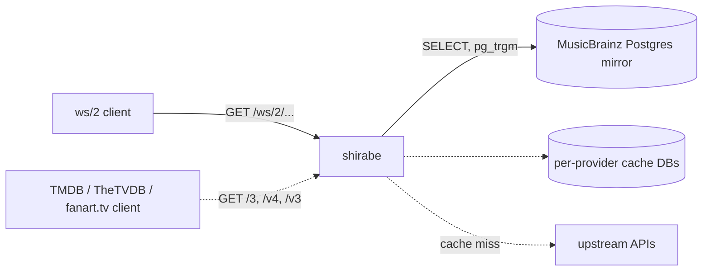

# shirabe

MusicBrainz ws/2 search and lookups served from a Postgres mirror with pg_trgm, in place of the SOLR search stack.

[](https://github.com/DorskFR/shirabe/actions/workflows/ci.yml)
[](https://github.com/DorskFR/shirabe/pkgs/container/shirabe)
[](Cargo.toml)



```console
$ curl -s 'localhost:8800/ws/2/artist?query=seaside%20radoi' | jq .
{
  "count": 1,
  "offset": 0,
  "artists": [
    {
      "id": "11111111-1111-4111-8111-111111111111",
      "name": "Seaside Radio",
      "score": 65,
      "aliases": [
        {
          "name": "Régio Costera",
          "sort-name": "Costera, Régio"
        }
      ],
      "disambiguation": "test band",
      "type": "Group",
      "country": "GB"
    }
  ]
}
```

^ A typo'd artist search against the test fixture. `score` is the trigram similarity scaled to 0-100.

Running your own MusicBrainz search normally means the full ws/2 server plus Apache SOLR and its index rebuilds. Most clients only call a handful of ws/2 endpoints, so shirabe answers those straight from the replicated `musicbrainz` Postgres schema and returns MusicBrainz's hyphenated-key JSON, which lets an existing ws/2 client parser and its confidence re-scoring work unchanged. It also fronts TMDB, TheTVDB, fanart.tv and the Cover Art Archive under their native API paths as cache-first proxies, so one host serves all of a media app's metadata lookups. `調べ` (shirabe) means "to look up".

## Quick start

This runs the published image against the small fake dataset in `tests/fixtures/musicbrainz.sql` (two artists, four releases), so you can try it without a mirror. Requires Docker and a clone of the repo.

```sh
git clone https://github.com/DorskFR/shirabe && cd shirabe
docker network create shirabe
docker run -d --name mb-fixture --network shirabe -e POSTGRES_PASSWORD=mb postgres:17
until docker exec mb-fixture pg_isready -q -h 127.0.0.1 -U postgres; do sleep 1; done
cat tests/fixtures/musicbrainz.sql migrations/000*.sql | docker exec -i mb-fixture psql -q -U postgres
docker run --rm -d --name shirabe --network shirabe -p 8800:8800 \
  -e DATABASE_URL=postgres://postgres:mb@mb-fixture/postgres ghcr.io/dorskfr/shirabe:0.8.3
```

```console
$ curl -s localhost:8800/health
{"status":"ok"}
```

Clean up with `docker rm -f shirabe mb-fixture && docker network rm shirabe`.

To serve real data, set `DATABASE_URL` to a MusicBrainz mirror (for example one built with [musicbrainz-docker](https://github.com/metabrainz/musicbrainz-docker)) after applying `migrations/000*.sql` to it once. Those add the trigram and full-text indexes and never touch replicated data; see [docs/deployment.md](docs/deployment.md).

## Usage

### Search releases by title and artist

`query=` takes the fielded Lucene subset ws/2 clients send: `release:`, `artist:`, `recording:`, `date:(YYYY*)`, `arid:`, `primarytype:`, `status:`, with quotes, `(...)` groups and `AND`. The fuzzy suffix `term~` is stripped, since the trigram match is already fuzzy.

```console
$ curl -sG localhost:8800/ws/2/release --data-urlencode 'query=release:(harbor lights) AND artist:(seaside radio)' -d limit=1 | jq .
{
  "count": 2,
  "offset": 0,
  "releases": [
    {
      "id": "33333333-3333-4333-8333-333333333333",
      "title": "Harbour Lights",
      "date": "1997-05-21",
      "score": 71,
      "status": "Official",
      "disambiguation": "deluxe edition",
      "artist-credit": [
        {
          "artist": {
            "id": "11111111-1111-4111-8111-111111111111",
            "name": "Seaside Radio"
          }
        }
      ],
      "track-count": 2,
      "release-group": {
        "id": "22222222-2222-4222-8222-222222222222",
        "primary-type": "Album"
      }
    }
  ]
}
```

### Browse an artist's release groups

```console
$ curl -s 'localhost:8800/ws/2/release-group?artist=11111111-1111-4111-8111-111111111111' | jq -c .
{"release-group-count":1,"release-group-offset":0,"release-groups":[{"id":"22222222-2222-4222-8222-222222222222","title":"Harbour Lights","primary-type":"Album","secondary-types":["Live"],"first-release-date":"1997-05-21","disambiguation":"rg comment","artist-credit":[{"artist":{"id":"11111111-1111-4111-8111-111111111111","name":"Seaside Radio"}}]}]}
```

### Point a ws/2 client at shirabe

Set the client's MusicBrainz base URL to `http://<host>:8800/ws/2` instead of `https://musicbrainz.org/ws/2`. The paths and JSON shapes are the same, and since the queries hit your own database the 1 request/second courtesy limit no longer applies. The other providers follow the same pattern:

```
musicbrainz.base_url = http://shirabe:8800/ws/2
tmdb.base_url        = http://shirabe:8800/3
tvdb.base_url        = http://shirabe:8800/v4
fanart.base_url      = http://shirabe:8800/v3
coverart.base_url    = http://shirabe:8800
```

For TMDB, TheTVDB and fanart.tv, shirabe ignores the client's API key and uses its own server-side key.

## Endpoints

| Method | Path | Returns |
|---|---|---|
| `GET` | `/ws/2/artist`, `/ws/2/release`, `/ws/2/recording` `?query=` | ws/2 search envelope `{"count", "offset", "<plural>": [...]}` |
| `GET` | `/ws/2/{artist,release,recording,release-group}/{mbid}` | Lookup, with the `inc=` tokens listed in the API doc |
| `GET` | `/ws/2/release-group?artist=<mbid>` | Release groups of an artist |
| `GET` | `/3/*`, `/v4/*`, `/v3/*` | TMDB, TheTVDB and fanart.tv in their native shapes, cache-first |
| `GET` | `/release/*`, `/release-group/*`, `/_ia/*` | Cover Art Archive redirects and an on-disk image byte cache |
| `GET` | `/health` | `{"status":"ok"}` when the mirror is reachable |
| `GET` | `/health/sources` | Per-source health and staleness (diagnostic, not a probe) |

Unknown paths return JSON: `404 {"error":"shirabe: no such route: GET /ws/2/label"}`. Every prefix also has a provider alias (`/musicbrainz/ws/2`, `/music`, `/tmdb/3`, ...). The full route inventory, `inc=` tokens, error shapes and storage model are in [docs/shirabe-api-contract.md](docs/shirabe-api-contract.md).

## Configuration

| Variable | Default | Effect |
|---|---|---|
| `DATABASE_URL` | required | MusicBrainz mirror DSN; shirabe only runs `SELECT`, so use a read-only role |
| `SHIRABE_BIND` | `0.0.0.0:8800` | Listen address |
| `SHIRABE_SIMILARITY_THRESHOLD` | `0.3` | Minimum `pg_trgm` similarity for a search hit |
| `SHIRABE_DEFAULT_LIMIT` / `SHIRABE_MAX_LIMIT` | `25` / `100` | Default and maximum search `limit` |
| `TMDB_API_KEY`, `TVDB_API_KEY`, `FANART_API_KEY` | unset | Server-side provider keys; without one that facade serves cached rows only |
| `RUST_LOG` | `info` | Log filter; `info` logs one access line per request |

Every variable, including the per-provider database URLs, the image cache and OpenTelemetry export, is in [docs/configuration.md](docs/configuration.md) and [`.env.example`](.env.example). Each one is also a `--flag` (`shirabe --help`). Container, probes, migrations and the `sync` / `migrate` subcommands are covered in [docs/deployment.md](docs/deployment.md).

## Limitations

- Only the endpoints above are implemented. Labels, works, events, places and other ws/2 entities return 404.
- `query=` is not full Lucene: the known fields are always combined as `AND`, `OR` is not evaluated, and unknown fields are ignored.
- `fmt=xml` is accepted but the response is always JSON.
- `score` comes from trigram similarity, so it will not match musicbrainz.org's SOLR scores for the same query.
- There are no write endpoints; the mirror is read-only and kept current by MusicBrainz replication, not by shirabe.

## Development

```sh
git clone https://github.com/DorskFR/shirabe && cd shirabe
make test               # cargo test, no database needed
make db/up              # throwaway postgres:17 on port 5490
make test-integration   # adds the DB-gated tests, seeding tests/fixtures/musicbrainz.sql
make lint               # cargo clippy --all-targets -- -D warnings
make fmt                # cargo +nightly fmt (unstable options)
make run                # cargo run, needs DATABASE_URL
```

Requires Rust 1.94 or newer, plus a nightly toolchain for `rustfmt`. The JSON responses in this README come from the Quick start setup above.

## License

WTFPL, as declared in [`Cargo.toml`](Cargo.toml). The repository has no `LICENSE` file.
