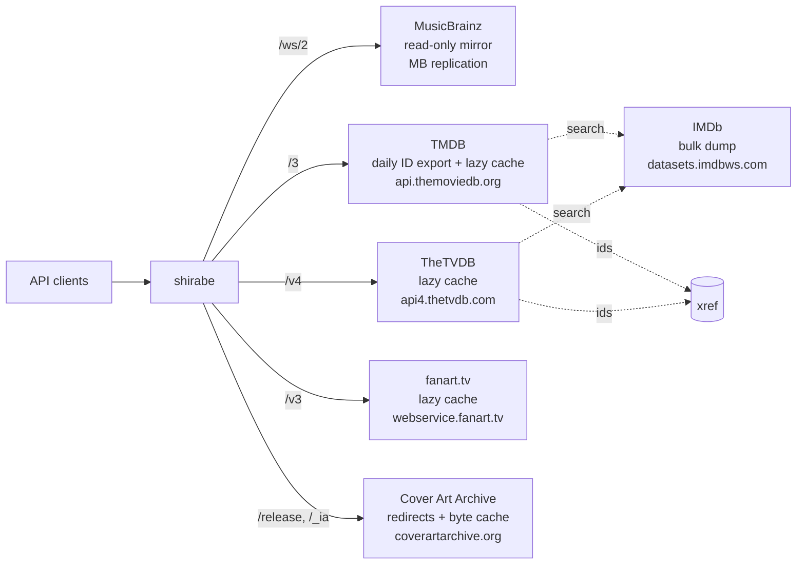

# shirabe

MusicBrainz, TMDB, TheTVDB, fanart.tv and Cover Art Archive APIs served from local Postgres mirrors and caches.

[](https://github.com/DorskFR/shirabe/actions/workflows/ci.yml)
[](https://github.com/DorskFR/shirabe/pkgs/container/shirabe)
[](Cargo.toml)



```console
$ curl -s 'localhost:8800/ws/2/artist?query=seaside%20radoi' | jq .
{
  "count": 1,
  "offset": 0,
  "artists": [
    {
      "id": "11111111-1111-4111-8111-111111111111",
      "name": "Seaside Radio",
      "score": 65,
      "aliases": [
        {
          "name": "Régio Costera",
          "sort-name": "Costera, Régio"
        }
      ],
      "disambiguation": "test band",
      "type": "Group",
      "country": "GB"
    }
  ]
}
```

`score` is trigram similarity scaled to 0-100.

Each API keeps its native paths and JSON shapes, so existing clients only change their base URL; ws/2 search runs on `pg_trgm` instead of SOLR. TMDB and TheTVDB searches also consult a local IMDb title index, and cross-provider ids from their payloads go into an `xref` table.

## Quick start

Published image against the fixture in `tests/fixtures/musicbrainz.sql` (two artists, four releases). Requires Docker.

```sh
git clone https://github.com/DorskFR/shirabe && cd shirabe
docker network create shirabe
docker run -d --name mb-fixture --network shirabe -e POSTGRES_PASSWORD=mb postgres:17
until docker exec mb-fixture pg_isready -q -h 127.0.0.1 -U postgres; do sleep 1; done
cat tests/fixtures/musicbrainz.sql migrations/000*.sql | docker exec -i mb-fixture psql -q -U postgres
docker run --rm -d --name shirabe --network shirabe -p 8800:8800 \
  -e DATABASE_URL=postgres://postgres:mb@mb-fixture/postgres ghcr.io/dorskfr/shirabe:0.8.3
```

```console
$ curl -s localhost:8800/health
{"status":"ok"}
```

```sh
docker rm -f shirabe mb-fixture && docker network rm shirabe
```

For a real mirror, apply `migrations/000*.sql` once and set `DATABASE_URL`: [docs/deployment.md](docs/deployment.md).

## Usage

### Search releases by title and artist

`query=` fields: `release:`, `artist:`, `recording:`, `date:(YYYY*)`, `arid:`, `primarytype:`, `status:`.

```console
$ curl -sG localhost:8800/ws/2/release --data-urlencode 'query=release:(harbor lights) AND artist:(seaside radio)' -d limit=1 | jq .
{
  "count": 2,
  "offset": 0,
  "releases": [
    {
      "id": "33333333-3333-4333-8333-333333333333",
      "title": "Harbour Lights",
      "date": "1997-05-21",
      "score": 71,
      "status": "Official",
      "disambiguation": "deluxe edition",
      "artist-credit": [
        {
          "artist": {
            "id": "11111111-1111-4111-8111-111111111111",
            "name": "Seaside Radio"
          }
        }
      ],
      "track-count": 2,
      "release-group": {
        "id": "22222222-2222-4222-8222-222222222222",
        "primary-type": "Album"
      }
    }
  ]
}
```

### Browse an artist's release groups

```console
$ curl -s 'localhost:8800/ws/2/release-group?artist=11111111-1111-4111-8111-111111111111' | jq -c .
{"release-group-count":1,"release-group-offset":0,"release-groups":[{"id":"22222222-2222-4222-8222-222222222222","title":"Harbour Lights","primary-type":"Album","secondary-types":["Live"],"first-release-date":"1997-05-21","disambiguation":"rg comment","artist-credit":[{"artist":{"id":"11111111-1111-4111-8111-111111111111","name":"Seaside Radio"}}]}]}
```

### Point clients at shirabe

```
musicbrainz.base_url = http://shirabe:8800/ws/2
tmdb.base_url        = http://shirabe:8800/3
tvdb.base_url        = http://shirabe:8800/v4
fanart.base_url      = http://shirabe:8800/v3
coverart.base_url    = http://shirabe:8800
```

Client API keys are ignored; shirabe uses its own server-side keys. Details: [docs/shirabe-api-contract.md](docs/shirabe-api-contract.md#1-the-facade-approach).

## Endpoints

| Method | Path | Returns |
|---|---|---|
| `GET` | `/ws/2/artist`, `/ws/2/release`, `/ws/2/recording` `?query=` | ws/2 search envelope `{"count", "offset", "<plural>": [...]}` |
| `GET` | `/ws/2/{artist,release,recording,release-group}/{mbid}` | Lookup, with the `inc=` tokens listed in the API doc |
| `GET` | `/ws/2/release-group?artist=<mbid>` | Release groups of an artist |
| `GET` | `/3/*`, `/v4/*`, `/v3/*` | TMDB, TheTVDB and fanart.tv in their native shapes, cache-first |
| `GET` | `/release/*`, `/release-group/*`, `/_ia/*` | Cover Art Archive redirects and an on-disk image byte cache |
| `GET` | `/health` | `{"status":"ok"}` when the mirror is reachable |
| `GET` | `/health/sources` | Per-source health and staleness (diagnostic, not a probe) |

Unknown paths: `404 {"error":"shirabe: no such route: GET /ws/2/label"}`. Aliases, `inc=` tokens, error shapes and storage model: [docs/shirabe-api-contract.md](docs/shirabe-api-contract.md).

## Configuration

| Variable | Default | Effect |
|---|---|---|
| `DATABASE_URL` | required | MusicBrainz mirror DSN; `SELECT` only, read-only role suffices |
| `SHIRABE_BIND` | `0.0.0.0:8800` | Listen address |
| `SHIRABE_SIMILARITY_THRESHOLD` | `0.3` | Minimum `pg_trgm` similarity for a search hit |
| `SHIRABE_DEFAULT_LIMIT` / `SHIRABE_MAX_LIMIT` | `25` / `100` | Default and maximum search `limit` |
| `TMDB_API_KEY`, `TVDB_API_KEY`, `FANART_API_KEY` | unset | Server-side provider keys; without one that facade serves cached rows only |
| `RUST_LOG` | `info` | Log filter; `info` logs one access line per request |

Full list, also available as `--flag`s: [docs/configuration.md](docs/configuration.md). Container, probes, `sync` and `migrate`: [docs/deployment.md](docs/deployment.md).

## Limitations

- Endpoints above only. Labels, works, events, places: 404.
- `query=` is not full Lucene: fields always `AND`ed, no `OR`, unknown fields ignored, `term~` stripped.
- `fmt=xml` returns JSON.
- `score` will not match musicbrainz.org's SOLR scores.
- No write endpoints. The MusicBrainz mirror is updated by replication, not by shirabe.

## Development

```sh
git clone https://github.com/DorskFR/shirabe && cd shirabe
make test               # cargo test, no database needed
make db/up              # throwaway postgres:17 on port 5490
make test-integration   # adds the DB-gated tests, seeding tests/fixtures/musicbrainz.sql
make lint               # cargo clippy --all-targets -- -D warnings
make fmt                # cargo +nightly fmt (unstable options)
make run                # cargo run, needs DATABASE_URL
```

Rust 1.94+, nightly for `rustfmt`.

## License

WTFPL, declared in [`Cargo.toml`](Cargo.toml). No `LICENSE` file.
